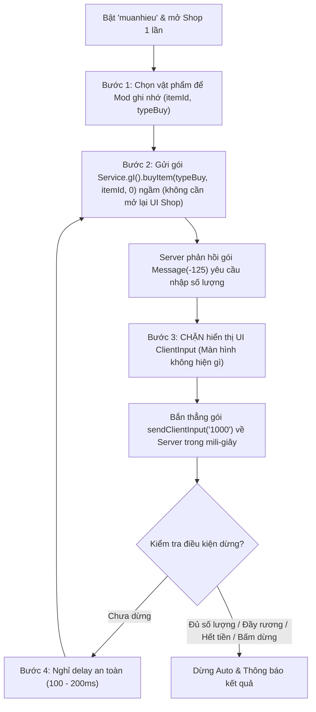

# Kế Hoạch Triển Khai Chức Năng Auto Mua Nhiều (`Automuanhieu`)

## 1. Mục tiêu
Tự động hóa luồng mua vật phẩm số lượng lớn kết hợp với lệnh `"muanhieu"` của Server:
- **Ẩn hoàn toàn giao diện nhập liệu:** Người chơi **không nhìn thấy bất kỳ bảng/ô nhập nào** xuất hiện trên màn hình trong suốt quá trình auto.
- **Tự động bắt tay gói tin ngầm (Hidden Handshake - Phương án 1):** Khi Server yêu cầu nhập số lượng (gói `Message(-125)`), Mod sẽ chặn không cho bảng `ClientInput` hiện lên và lập tức bắn thẳng giá trị `"1000"` (hoặc số lượng cài đặt) về Server trong mili-giây.
- **Tự động lặp lại liên tục** với độ trễ an toàn chống văng/disconnect cho đến khi đủ số lượng, đầy rương, hết tiền hoặc người chơi chủ động dừng.

---

## 2. Phân tích Cơ chế Gốc của Game (Client & Server)

1. **Kích hoạt chế độ `"muanhieu"`:**
   - Người chơi chat `"muanhieu"` -> [`GameScr.onChatFromMe`](file:///c:/Users/admin/Documents/Nro2/DecompiledSource/Game1/GameScr.cs#L6230-L6294) gửi [`Service.gI().chat("muanhieu")`](file:///c:/Users/admin/Documents/Nro2/DecompiledSource/Game1/GameScr.cs#L6292) lên Server.
   - Server kích hoạt trạng thái mua nhiều và trả về thông báo: *"Đã bật auto mua số lượng lớn. Hãy bấm vào vật phẩm trong shop để chọn số lượng"*.

2. **Chọn vật phẩm và gửi yêu cầu mua x1:**
   - Trong Shop, khi bấm vào một vật phẩm, [`Panel.cs`](file:///c:/Users/admin/Documents/Nro2/DecompiledSource/Game1/Panel.cs#L8569) gán vật phẩm vào `GameCanvas.panel.currItem`.
   - Khi bấm mua x1 (`idAction` = `3005`, `3000`, hoặc `3001`), [`Panel.perform`](file:///c:/Users/admin/Documents/Nro2/DecompiledSource/Game1/Panel.cs#L10347-L10381) gọi [`Service.gI().buyItem(typeBuy, item.template.id, 0)`](file:///c:/Users/admin/Documents/Nro2/DecompiledSource/Game1/Service.cs#L954-L976) (gửi gói `Message(6)` lên Server).

3. **Server yêu cầu nhập số lượng (`Message -125`):**
   - Tại [`Controller2.readMessage` (case `-125`)](file:///c:/Users/admin/Documents/Nro2/DecompiledSource/Game1.Assets.src.f/Controller2.cs#L37-L62), Client nhận gói `-125` và gọi [`ClientInput.gI().setInput(type, title)`](file:///c:/Users/admin/Documents/Nro2/DecompiledSource/Game1.Assets.src.g/ClientInput.cs#L81-L86) làm bật popup `ClientInput` lên màn hình.

4. **Client phản hồi số lượng (`Message -125`):**
   - [`Service.gI().sendClientInput(tf)`](file:///c:/Users/admin/Documents/Nro2/DecompiledSource/Game1/Service.cs#L195-L217) gửi gói `Message(-125)` chứa chuỗi số lượng lên Server.
   - Lưu ý: Gói tin này **không mang ID vật phẩm** mà chỉ mang số lượng. Do đó, Server cần nhận `buyItem` trước để xác định vật phẩm trước khi nhận số lượng.

---

## 3. Luồng Hoạt Động (Phương án 1: Bắt tay ngầm - Ẩn hoàn toàn ô nhập)

### Chi tiết 4 bước kỹ thuật:

#### Bước 1: Nhận diện và ghi nhớ vật phẩm
- Bắt sự kiện người chơi bấm mua vật phẩm trong Shop lần đầu khi chế độ Auto đang ở trạng thái "Chờ chọn vật phẩm":
  - `targetItemId` (`int`): `currItem.template.id`
  - `targetItemName` (`string`): `currItem.template.name`
  - `targetBuyType` (`sbyte`): `3` (mua đặc biệt/3005), `0` (vàng/3000), hoặc `1` (ngọc/3001).
- Người chơi có thể đóng bảng Shop sau khi đã chọn xong.

#### Bước 2: Tự động gửi gói `buyItem` ngầm
- Gọi trực tiếp `Service.gI().buyItem(targetBuyType, targetItemId, 0)` từ code mà **không cần mở lại giao diện Shop**.
- Điều kiện Server: Người chơi giữ nguyên vị trí bản đồ (không đổi map hay tương tác đè với NPC khác làm mất `shopId` trên phiên Server).

#### Bước 3: Chặn hoàn toàn UI `ClientInput` và bắn thẳng `"1000"` về Server
- Sử dụng **Harmony Patch Prefix** trên hàm [`ClientInput.setInput(int type, string title)`](file:///c:/Users/admin/Documents/Nro2/DecompiledSource/Game1.Assets.src.g/ClientInput.cs#L81-L86) (hoặc trực tiếp tại `Controller2` case `-125`):
  - Khi cờ `isAutoBulkBuy` đang bật:
    1. **Trả về `false`** để hủy hoàn toàn việc gọi `init()` và `switchToMe()`.
    2. Giao diện game giữ nguyên, **không hề xuất hiện ô nhập hay popup nào**.
    3. Tạo mảng `TField` ảo (hoặc trực tiếp dựng `Message(-125)`), điền chuỗi số lượng (mặc định `"1000"`).
    4. Gọi ngay `Service.gI().sendClientInput(tf)` bắn thẳng về Server trong vòng vài mili-giây.

#### Bước 4: Vòng lặp đồng bộ có delay chống văng (Handshake Loop)
- **Tính an toàn tuyệt đối:** Vì gói `sendClientInput("1000")` chỉ được bắn ra ngay sau khi Server vừa phát tín hiệu `-125`, nên Server luôn ở đúng trạng thái sẵn sàng nhận -> **Không bao giờ bị lỗi lệch nhịp hay mất gói**.
- Sau khi gửi xong 1 đợt 1000 món:
  - Nghỉ một khoảng `delayBetweenRounds` (cấu hình mặc định `150ms`, có thể chỉnh `100ms - 300ms`).
  - Kiểm tra điều kiện dừng: đã mua đủ số đợt cài đặt chưa, hoặc có tín hiệu dừng từ người chơi / lỗi từ Server hay không.
  - Nếu chưa dừng, quay lại Bước 2 để mua tiếp đợt tiếp theo.
- **Tốc độ thực tế:** Đạt khoảng **3.000 – 5.000 món / giây** mà game vẫn mượt mà, không giật lag.

---

## 4. Các Lệnh Điều Khiển & Cấu Hình Dự Kiến

| Lệnh Chat / Thao tác | Chức năng |
| :--- | :--- |
| `amn` hoặc `automua` | Bật/Tắt chế độ Auto Mua Nhiều. Khi bật, nếu chưa chat `"muanhieu"` thì Mod sẽ tự động gửi chat `"muanhieu"` lên Server. |
| `amn sl <số_lượng>` | Cài số lượng mua mỗi đợt (mặc định `1000`, tối đa `1000`). |
| `amn lap <số_đợt>` | Cài số đợt mua (VD: `amn lap 5` để mua 5 đợt x 1000 = 5000 món; `0` = lặp liên tục cho đến khi bấm dừng hoặc đầy rương). |
| `amn delay <ms>` | Chỉnh thời gian nghỉ giữa các đợt mua (mặc định `150ms`). |
| Phím `Q` (hoặc chat `amn`) | Dừng khẩn cấp vòng lặp Auto Mua Nhiều ngay lập tức. |

---

## 5. Cơ Chế Tự Dừng An Toàn (Fail-safe)

1. **Dừng khi nhận thông báo lỗi từ Server:**
   - Hook vào [`GameScr.info1.addInfo`](file:///c:/Users/admin/Documents/Nro2/DecompiledSource/Game1/Info.cs) và `GameCanvas.startOKDlg`.
   - Nếu Server trả về thông báo: *"Hành trang đã đầy"*, *"Không đủ vàng/ngọc"*, *"Không đủ chỗ trống"*... -> Tự động ngắt vòng lặp Auto và thông báo cho người chơi.
2. **Timeout an toàn:**
   - Nếu gửi `buyItem` mà sau `2000ms` Server không phản hồi gói `-125` (do mạng lag hoặc mất kết nối), Mod sẽ tự ngắt trạng thái để tránh treo vòng lặp.
3. **Tương thích cả 2 Namespace:**
   - Hỗ trợ đầy đủ cả `Game1` và `Game2` có trong client.
