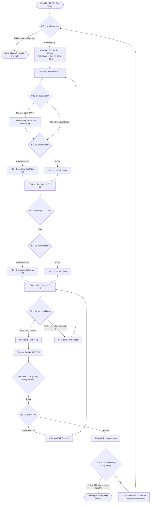

# ĐẶC TẢ TÍNH NĂNG TOÀN DIỆN: "AUTO GỘP" (WORKFLOW AUTOMATION)

Tài liệu này phản ánh chính xác cấu trúc, logic vận hành, thông số cài đặt, giao diện, phím tắt và các cơ chế bảo vệ chống treo/đơ máy của hệ thống **Auto Gộp** hiện hành trong mã nguồn game.

---

## I. TỔNG QUAN HỆ THỐNG

Hệ thống **Auto Gộp** quản lý 5 Tab chức năng chuyên biệt:
* **Tab 0: Chung** (`ID: 0`) – Bộ chỉ huy điều phối quy trình tổng thể.
* **Tab 1: Bánh** (`ID: 1`) – Mua & Tự động sử dụng Bánh tại Goku (NPC 92).
* **Tab 2: HN** (`ID: 2`) – Mua & Sử dụng Hồn Nước tại NPC 56.
* **Tab 3: Điểm** (`ID: 3`) – Đổi Điểm Nồi Bánh tại NPC 66.
* **Tab 4: Zeno** (`ID: 4`) – Đổi Tiên Phù Zeno tại Thần Mèo Karin (NPC 18).

---

## II. BẢNG QUẢN LÝ PHÍM TẮT & LỆNH ĐIỀU KHIỂN

### 1. Phím Tắt Bàn Phím (Hotkeys)
| Phím tắt | Tác vụ thực thi |
| :--- | :--- |
| **Phím X** | Mở Menu Mod $\rightarrow$ Chọn **Auto Gộp** để Bật/Tắt cửa sổ điều khiển |
| **Phím F3** | **BẮT ĐẦU** chạy toàn bộ quy trình Auto Gộp tuần tự theo thiết lập tại **Tab Chung** |
| **Phím F4** | Khởi chạy độc lập chức năng **Tab 1: Bánh** |
| **Phím F5** | Khởi chạy độc lập chức năng **Tab 2: HN** |
| **Phím F7** | Khởi chạy độc lập chức năng **Tab 3: Điểm** |
| **Phím F8** | Khởi chạy độc lập chức năng **Tab 4: Zeno** |
| **Phím F6** hoặc **Phím A** | **DỪNG KHẨN CẤP TOÀN BỘ (Global Stop)** tất cả tiến trình đang thực thi |

### 2. Lệnh Chat (Chat Commands)
Người chơi có thể gõ các lệnh sau vào khung chat trong game:
* `gop` hoặc `autogop`: Bật/Tắt cửa sổ giao diện Auto Gộp.
* `f3` hoặc `chaygop`: Bắt đầu chạy quy trình tổng thể (tương đương phím F3).
* `f6` hoặc `dunggop`: Dừng toàn bộ hệ thống (tương đương phím F6).

---

## III. CHI TIẾT 5 TAB CHỨC NĂNG & THÔNG SỐ ĐÃ HOÀN THIỆN

```
┌────────────────────────────────────────────────────────┐
│ [ Chung ]   [ Bánh ]   [ HN ]   [ Điểm ]   [ Zeno ]    │
└────────────────────────────────────────────────────────┘
```

---

### 1. Tab 0: Chung (`ID: 0`) - Điều Phối Quy Trình Tổng Thể

Tab này đóng vai trò là "Bộ chỉ huy", liên kết 4 tiến trình con thành một chuỗi vòng tròn khép kín hoặc chạy có số vòng nhất định.

* **Danh sách chức năng & Thứ tự chạy:**
  * `[v] 1. Auto Bánh (92)` (`enableBanh`): Bật/Tắt tham gia quy trình. Ô nhập thứ tự `orderBanh` (Mặc định: 1).
  * `[v] 2. Auto HN (56)` (`enableHn`): Bật/Tắt tham gia quy trình. Ô nhập thứ tự `orderHn` (Mặc định: 4).
  * `[v] 3. Đổi Điểm (66)` (`enableDiem`): Bật/Tắt tham gia quy trình. Ô nhập thứ tự `orderDiem` (Mặc định: 2).
  * `[v] 4. Đổi Zeno (18)` (`enableZeno`): Bật/Tắt tham gia quy trình. Ô nhập thứ tự `orderZeno` (Mặc định: 3).
  * *Hàng đợi thực thi mặc định:* **Bánh (1) $\rightarrow$ Điểm (2) $\rightarrow$ Zeno (3) $\rightarrow$ HN (4)**.
* **Cấu hình độ trễ & Vòng lặp:**
  * **Delay chuyển giao (ms)** (`delayBetweenTabsMs`): Thời gian nghỉ an toàn sau khi kết thúc một tab trước khi khởi chạy tab kế tiếp (Mặc định: `500 ms`, tối thiểu `50 ms`).
  * **Số vòng lặp (0=∞)** (`targetWorkflowLoops`):
    * Nhập `0`: Chạy tuần hoàn vô hạn (`Vòng 1/∞`).
    * Nhập `N > 0`: Tự dừng toàn bộ sau khi hoàn thành đúng `N` vòng lặp.
  * **Hiển thị Real-time:** Bộ đếm `Vòng x/y` và thông tin trạng thái tab đang hoạt động.
* **Tự động kích hoạt tính năng Server:**
  * `[v] Tự bật Mua Nhiều (muanhieu)` (`autoChatMuaNhieu`): Tự động chat chuỗi `"muanhieu"` lên server ngay khi vào Tab Bánh hoặc Tab HN để mở khóa mua số lượng lớn (Mặc định: Tắt).
* **Bộ tối ưu hiệu năng & Giảm giật lag:**
  * `[v] Ẩn người&quái` (`hidePlayersAndMobs`): Bỏ qua hàm vẽ (paint) người chơi khác và quái xung quanh.
  * `[v] Tắt chữ bay` (`hideFlyInfoMessages`): Chặn các hiệu ứng chuỗi chữ thông báo bay trên đầu nhân vật, giảm đáng kể tải CPU/GPU.
  * `hideUi = true`: Ẩn hoàn toàn bảng menu NPC, panel shop và popup chat khi auto đang thực thi.
* **Bảo vệ toàn vòng (`progressThisLoop`):**
  * Trong suốt 1 vòng lặp, nếu tất cả các tab đều không mua/đổi được vật phẩm nào (do hết sạch toàn bộ tài nguyên: Hồng ngọc, Điểm, Vé Zeno, Zeno...) $\rightarrow$ Hệ thống tự dừng an toàn ngay lập tức kèm cảnh báo, tránh chạy vòng lặp ảo gây tốn tài nguyên máy.

---

### 2. Tab 1: Bánh (`ID: 1`) - Mua & Dùng Bánh Tại Goku

* **Thông số cố định:**
  * **Vật phẩm:** Bánh (ID mặc định `1337`).
  * **NPC phục vụ:** Goku Sự Kiện (NPC ID `92`, Map Kame - ID `5`).
  * **Loại mua Shop:** `targetBuyTypeBanh = 3`.
* **Hiển thị Real-time trên giao diện:**
  * Dòng số lượng bánh trong rương: **`Bánh: [Số lượng]`** (quét từ `arrItemBag`).
  * Dòng số dư Hồng Ngọc: **`H.Ngọc: [Số dư]`** (Đọc từ `Char.myCharz().luongKhoa` hoặc Ruby ID `861`, rút gọn theo chuẩn `K`, `M`, `B` như `1.25B`, `50M`).
* **Cấu hình đợt mua:**
  * **Số lượng / đợt** (`batchQtyBanh`): Số lượng bánh mua trong 1 lần gửi gói tin (Mặc định: `1000`, min 1, max 1000).
  * **Độ trễ mỗi đợt** (`delayBuyBanhMs`): Thời gian chờ giữa 2 lần mua liên tiếp (Mặc định: `600 ms`).
* **Hệ thống điều kiện dừng (Hỗ trợ tích chọn đồng thời cả 3 ĐK):**
  * `[ ] ĐK 1: Đủ số đợt mua` (`stopBanhCond1` + `targetBatchesBanh`): Dừng khi đạt chỉ tiêu số đợt (Mặc định: `50` đợt). 
  * `[v] ĐK 2: Đầy rương / Hết tài nguyên` (`stopBanhCond2`): Dừng khi rương hết ô trống hoặc thiếu Hồng Ngọc / Ruby / nguyên liệu icon (Mặc định: Bật).
  * `[v] ĐK 3: Đạt mốc -> Dùng hết` (`stopBanhCond3` + `targetItemCountBanh`):
    * Khi số lượng bánh trong rương $\ge$ Mốc chỉ định (Mặc định: `5000` cái): Tự động ngừng mua và chuyển sang chế độ **Tự động dùng sạch bánh trong rương** (`isUsingAllBanh`).
    * Tốc độ dùng bánh: Cứ mỗi `delayUseBanhMs` (`200 ms`) tự động gọi `UseItemInBag(1337)`.
    * Khi rương sạch bóng bánh $\rightarrow$ Hoàn tất Tab Bánh và chuyển bước.
  * *Quy tắc phối hợp:* Nếu ĐK 2 kích hoạt (rương đầy hoặc hết hồng ngọc) mà trong rương vẫn còn bánh (khi có bật ĐK 3), tool sẽ tự dùng hết số bánh hiện có trước khi chuyển sang tab kế tiếp.
* **Cơ chế rẽ nhánh cục bộ (Local Routing):**
  * `[v] Rẽ nhánh khi xong ->` (`enableRoutingBanh`): Tùy chọn bật/tắt rẽ nhánh.
  * Ô nhập Tab đích (`routeTargetTabBanh`): Mặc định nhảy sang **Tab Điểm (ID: 3)**.

---

### 3. Tab 2: HN (`ID: 2`) - Mua & Sử Dụng Hồn Nước

* **Thông số cố định:**
  * **Vật phẩm:** Hồn Nước (ID mặc định `1581`).
  * **NPC phục vụ:** NPC ID `56` (Map Kame - ID `5`).
  * **Loại mua Shop:** `targetBuyTypeHn = 3`.
  * **Vật phẩm tiêu hao để mua:** Zeno (Item ID `1378`). Giá: `40.000 Zeno / 1 HN`.
* **Hiển thị Real-time trên giao diện:**
  * Dòng số HN trong rương: **`Rương: [Số lượng]`**.
  * Dòng số lượng Zeno hiện có: **`Zeno: [Số lượng]`** (Rút gọn định dạng `K`, `M`, `B`).
* **Cấu hình đợt mua:**
  * **Số lượng / đợt** (`batchQtyHn`): Mặc định `1000` (min 1, max 1000).
  * **Số đợt cần mua** (`targetBatchesHn`): Mặc định `50` đợt.
  * **Độ trễ mỗi đợt** (`delayBuyHnMs`): Mặc định `200 ms`.
  * `[v] Vừa mua vừa dùng (1581)` (`autoUseHn`): Sau mỗi đợt mua thành công, tự động kích hoạt dùng ngay 1 vật phẩm ID `1581` trong hành trang.
* **Hệ thống điều kiện dừng:**
  * `(o) ĐK 1: Đủ đợt` (`stopConditionHn = 1`): Dừng khi đạt `targetBatchesHn`.
  * `(o) ĐK 2: Đầy/Hết` (`stopConditionHn = 2`): Dừng khi rương đầy hoặc không đủ tiền/tài nguyên.
  * `[v] ĐK 3: Zeno < [Mốc] (SL x 40K)` (`stopHnCond3`):
    * Công thức tính mốc an toàn: $\text{Mốc Zeno} = \text{batchQtyHn} \times 40.000\text{ Zeno}$.
    * Ví dụ mua 1.000 cái $\rightarrow$ Mốc cần là `40.000.000 Zeno`.
    * Client chủ động kiểm tra trước (Pre-check): Nếu Zeno trong rương nhỏ hơn mốc này $\rightarrow$ Dừng mua ngay lập tức và chuyển tab, hoàn toàn không gửi gói tin lỗi lên server.
* **Cơ chế rẽ nhánh cục bộ (Local Routing):**
  * `[v] Rẽ nhánh khi xong ->` (`enableRoutingHn`): Mặc định bật.
  * Ô nhập Tab đích (`routeTargetTabHn`): Mặc định nhảy sang **Tab Zeno (ID: 4)**.

---

### 4. Tab 3: Điểm (`ID: 3`) - Đổi Điểm Nồi Bánh

* **Thông số cố định:**
  * **NPC phục vụ:** Nồi Bánh (NPC ID `66`, Map Kame - ID `5`).
* **Đọc điểm Real-time từ Server:**
  * Điểm làm bánh được trích xuất tự động qua biểu thức chính quy (Regex) từ lời thoại Menu cấp 1 của NPC 66 (`ParseDiemPoints`).
  * Có bộ lọc chống đọc nhầm các mốc chữ số tại Menu cấp 2.
  * Cảnh báo đồ họa góc phải: Nhãn đỏ **`Bật Lọc Đồ!`** để nhắc người chơi dọn rác rương.
* **Danh sách 5 mốc điểm hỗ trợ:**
  * `10Tr` ($10.000.000\text{đ}$)
  * `5K` ($5.000\text{đ}$)
  * `3K` ($3.000\text{đ}$)
  * `200` ($200\text{đ}$)
  * `50` ($50\text{đ}$)
* **Cơ chế tự động chọn mốc thông minh:**
  * `[v] Tự động chọn mốc (10Tr -> 5K -> 3K)` (`autoSelectMocDiem`):
    * Điểm $\ge 10.000.000\text{đ} \rightarrow$ Tự động chọn mốc **10Tr**.
    * Điểm $\ge 5.000\text{đ} \rightarrow$ Tự động chọn mốc **5K**.
    * Điểm $\ge 3.000\text{đ} \rightarrow$ Tự động chọn mốc **3K**.
    * Điểm $< 3.000\text{đ} \rightarrow$ Tự động kết luận hết điểm và chuyển tab.
* **Cấu hình & Điều kiện dừng:**
  * **Số lượt cần đổi** (`targetBatchesDiem`): Mặc định `50` lượt.
  * **Độ trễ mỗi lượt** (`delayDiemMs`): Mặc định `350 ms`.
  * `(o) ĐK 1: Đủ lượt` (`stopConditionDiem = 1`).
  * `(o) ĐK 2: Đầy/Hết điểm` (`stopConditionDiem = 2`): Dừng khi điểm hiện có nhỏ hơn mốc yêu cầu.
* **Cơ chế rẽ nhánh cục bộ (Local Routing):**
  * `[v] Rẽ nhánh khi xong ->` (`enableRoutingDiem`): Tùy chọn bật/tắt.
  * Ô nhập Tab đích (`routeTargetTabDiem`): Mặc định nhảy sang **Tab Zeno (ID: 4)**.

---

### 5. Tab 4: Zeno (`ID: 4`) - Đổi Tiên Phù Zeno Tại Karin

* **Thông số cố định:**
  * **Vật phẩm đổi:** Vé Zeno / Tiên Phù (Item ID `1583`).
  * **NPC phục vụ:** Thần Mèo Karin (NPC ID `18`, Tháp Karin - Map `46`).
* **Hiển thị Real-time trên giao diện:**
  * Hiển thị chính xác số lượng Vé Zeno (ID `1583`) đang có trong hành trang.
* **Cấu hình đợt đổi:**
  * **Số lượng / đợt** (`batchQtyZeno`): Mặc định `19.800` Tiên Phù (người dùng có thể chỉnh sửa tự do).
  * **Số đợt cần đổi** (`targetBatchesZeno`): Mặc định `1` đợt.
  * **Độ trễ mỗi đợt** (`delayZenoMs`): Mặc định `350 ms`.
* **Cơ chế chuyển luồng 2 nhánh song song (Dual Routing):**
  * **Nhánh 1 (Đạt mục tiêu / Đủ đợt):**
    * Checkbox độc lập `[v] Nhánh 1 (Đủ đợt) ->` (`enableRouteDoneZeno`).
    * Khi số đợt đổi đạt `targetBatchesZeno` $\rightarrow$ Tự động nhảy sang Tab đã cấu hình (Mặc định: **Tab HN - ID: 2**).
  * **Nhánh 2 (Thiếu vé):**
    * Checkbox độc lập `[v] Nhánh 2 (Vé < 19.800) ->` (`enableRouteLackZeno`).
    * Khi kiểm tra thấy số vé trong hành trang $< \text{batchQtyZeno}$ $\rightarrow$ Tự động nhảy sang Tab đã cấu hình (Mặc định: **Tab Bánh - ID: 1**).
* **Hỗ trợ tự động tìm đường XMap:**
  * Nếu nhân vật đang đứng ở map khác mà không có NPC 18 $\rightarrow$ Tự động kích hoạt thuật toán XMap di chuyển tới **Tháp Karin (Map 46)**, tiếp cận NPC 18 rồi mới tiến hành đổi.

---

## IV. SƠ ĐỒ LUỒNG ĐIỀU KHIỂN TOÀN CỤC (WORKFLOW EXECUTION)

### 1. Sơ Đồ Mermaid Quy Trình Tổng Thể



---

### 2. Thứ Tự Ưu Tiên Chuyển Tab (Routing Priority Rules)

Khi bất kỳ một Tab chức năng nào thỏa mãn điều kiện dừng:
1. **ƯU TIÊN 1 (Cao nhất) - Định Tuyến Cục Bộ (Local Routing):**
   * Nếu Checkbox rẽ nhánh của Tab đó đang **BẬT** VÀ Tab đích khác với chính nó:
   * $\rightarrow$ **Hệ thống lập tức nhảy thẳng sang Tab đích được chỉ định**, hoàn toàn bỏ qua thứ tự của hàng đợi Tab Chung.
2. **ƯU TIÊN 2 - Hàng Đợi Tab Chung (Workflow Queue):**
   * Nếu Local Routing tắt, hệ thống lấy tab tiếp theo theo thứ tự ưu tiên (1, 2, 3, 4) đã tích chọn tại Tab Chung.
3. **ƯU TIÊN 3 - Vòng Lặp Kế Tiếp:**
   * Khi hoàn thành tab cuối cùng trong hàng đợi $\rightarrow$ Tăng số vòng `completedWorkflowLoops++`, chuyển tiếp về tab đầu tiên.
4. **ƯU TIÊN 4 - Dừng Toàn Bộ:**
   * Kích hoạt khi đạt `targetWorkflowLoops` HOẶC khi cả một vòng không có bất kỳ tiến trình nào thực hiện được (`!progressThisLoop`).

---

### 3. Máy Trạng Thái Của Engine (Engine State Machine: `stepState 0 -> 7`)

```
[stepState = 1] ──> [stepState = 2] ──> [stepState = 3] ──> [stepState = 4] ──> [stepState = 5] ──> [stepState = 6]
 (Tiếp cận NPC)      (Chờ mở Menu)      (Mở Shop/Đổi)       (Nhập số lượng)    (Cooldown/Dùng)    (Chuyển Tab)
       │
       └── [stepState = 7: Chờ XMap di chuyển tới Map chứa NPC]
```

* **`stepState = 0` (Idle):** Trạng thái nghỉ hoàn toàn khi hệ thống dừng hoặc hoàn tất.
* **`stepState = 1` (Approach & Open):** Nhân vật di chuyển sát NPC mục tiêu (`MoveCloseToNpc`) và gửi gói tin `Service.gI().openMenu(npcId)`.
* **`stepState = 2` (Wait Menu):** Chờ gói tin Menu trả về từ server (`OnReceiveMenu`). Tự động chọn đúng dòng menu (Cửa hàng / Đổi điểm / Đổi Tiên Phù) và gửi xác nhận `confirmMenu`.
* **`stepState = 3` (Wait Shop):** Đón gói dữ liệu Shop (Packet `-44` $\rightarrow$ `OnShopOpened`), ẩn Panel Shop và kích hoạt lệnh mua.
* **`stepState = 4` (Wait Server Input - Packet `-125`):** Đón gói yêu cầu nhập số lượng từ Server, gửi số lượng trực tiếp qua Socket bằng hàm `SendClientInputDirect`, tăng biến đếm đợt mua và ghi nhận tiến độ vòng lặp.
* **`stepState = 5` (Cooldown & Sub-action):** Đếm lùi thời gian Delay cấu hình riêng của từng tab (`delayBuyBanhMs`, `delayBuyHnMs`, `delayDiemMs`, `delayZenoMs`). Thực thi các tác vụ phụ như tự dùng hết bánh (`UseItemInBag(1337)`) hoặc dùng HN (`UseItemInBag(1581)`).
* **`stepState = 6` (Transition Delay):** Nghỉ đệm an toàn giữa 2 Tab chức năng khác nhau (`delayBetweenTabsMs`) trước khi kích hoạt `StartTab(nextTab)`.
* **`stepState = 7` (Wait XMap):** Trạng thái chờ hệ thống XMap đưa nhân vật tới map đích nếu chưa ở đúng vị trí của NPC.

---

## V. CÁC CƠ CHẾ BẢO VỆ CHỐNG TREO, ĐƠ GAME & TỐI ƯU HIỆU NĂNG

1. **Triệt Tiêu Hoàn Toàn Lỗi Đơ Do Đệ Quy Thông Báo (Anti-Recursion):**
   * Sử dụng hàm thông báo riêng biệt `Notify(string text)` với cơ chế cờ kép `suppressInfoHook` và `inServerInfo`.
   * Khóa chặn hoàn toàn việc `InfoMe.addInfo` đưa chuỗi ngược trở lại `OnServerInfo`, ngăn chặn vĩnh viễn vòng lặp thông báo vô tận làm treo client.
2. **Kiểm Tra Trước Tại Client (Client Pre-check):**
   * Trước khi gửi lệnh mua, tool tự động kiểm tra trước: Ô trống hành trang, Số dư Xu, Ngọc, Hồng Ngọc, Ruby, Nguyên liệu Icon, và Số lượng Zeno.
   * Nếu không đủ điều kiện $\rightarrow$ Nhảy tab tức thì với độ trễ 0ms, không gửi gói tin rác lên server.
3. **Đánh Chặn & Hủy Popup Hộp Thoại Server (Packet Interception):**
   * **Gói `-26` (Dialog cảnh báo):** Khi server gửi popup báo lỗi (VD: *"Không đủ tiền"*, *"Hành trang đầy"*), tool lập tức gọi `GameCanvas.endDlg()` để đóng popup ngay lập tức, không để modal che khuất màn hình.
   * **Gói `38` (NPC ChatPopup):** Tự động ẩn bong bóng chat của NPC khi `hideUi = true`.
4. **Cơ Chế Timeout Fallback Đa Tầng:**
   * **Timeout gói `-125` (2.5s):** Chỉ retry tối đa 1 lần; nếu server không phản hồi $\rightarrow$ Xác định hết tài nguyên và chuyển tab ngay.
   * **Timeout mở NPC / Menu (3.5s x 3 lần):** Nếu sau 3 lần thử mở NPC thất bại $\rightarrow$ Tự động chuyển tab an toàn, không treo đứng nhân vật.
5. **Tối Ưu Tốc Độ & Phần Cứng:**
   * **Cache quét túi đồ (100ms):** Hàm `GetBagItemCount` lưu kết quả vào bộ nhớ đệm, giới hạn tối đa 10 lần duyệt mảng mỗi giây thay vì duyệt hàng trăm lần/frame.
   * **SendClientInputDirect:** Gửi trực tiếp byte stream qua session TCP, không thông qua đối tượng giao diện `TField`, tốc độ phản hồi tính bằng mili-giây.

---

## VI. PHÂN BỔ MÃ NGUỒN TRONG DỰ ÁN

| Đường dẫn tệp tin | Nội dung / Vai trò |
| :--- | :--- |
| `DecompiledSource/Game1.Mod/AutoGop.cs` | Logic chính của toàn bộ hệ thống Auto Gộp (Client Game 1) |
| `DecompiledSource/Game2.Mod/AutoGop.cs` | Bản đồng bộ hoàn toàn cho Client Game 2 (Namespace: `Game2.Mod`) |
| `DecompiledSource/Game1/Controller.cs` | Đánh chặn gói tin Shop (`-44`), Dialog (`-26`), Chat NPC (`38`), Điểm (`32`) |
| `DecompiledSource/Game1/Char.cs` & `Mob.cs` | Tùy biến bỏ qua vẽ nhân vật và quái khi `hidePlayersAndMobs = true` |
| `DecompiledSource/Game1/InfoMe.cs` | Lọc bỏ thông báo chữ bay khi `hideFlyInfoMessages = true` |
| `Kehoach/autogop.md` | Tài liệu đặc tả kỹ thuật và luồng vận hành chính thức của Auto Gộp |
