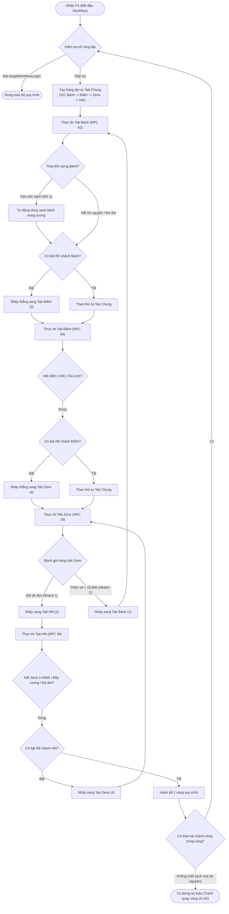

# TÀI LIỆU TOÀN DIỆN HỆ THỐNG: "AUTO GỘP" (WORKFLOW AUTOMATION)

Tài liệu này tổng hợp toàn bộ các tính năng đã có, thông số cấu hình, giao diện, phím tắt, cơ chế bảo vệ chống đơ/lag và chi tiết luồng hoạt động (workflow) của hệ thống **Auto Gộp** trong game.

---

## I. BẢNG QUẢN LÝ PHÍM TẮT & ĐIỀU KHIỂN

| Phím tắt / Thao tác | Tác vụ |
| :--- | :--- |
| **Phím X** | Mở Menu Mod $\rightarrow$ chọn **Auto Gộp** để bật/tắt cửa sổ điều khiển |
| **Phím F3** | **BẮT ĐẦU** chạy toàn bộ quy trình Auto Gộp tuần tự theo thiết lập tại **Tab Chung** |
| **Phím F4** | Khởi chạy độc lập chức năng **Tab 1: Bánh** |
| **Phím F5** | Khởi chạy độc lập chức năng **Tab 2: HN** |
| **Phím F7** | Khởi chạy độc lập chức năng **Tab 3: Điểm** |
| **Phím F8** | Khởi chạy độc lập chức năng **Tab 4: Zeno** |
| **Phím F6** hoặc **Phím A** | **DỪNG KHẨN CẤP TOÀN BỘ (Global Stop)** tất cả tiến trình đang thực thi |

---

## II. CHI TIẾT 5 TAB CHỨC NĂNG & THÔNG SỐ ĐÃ CÓ

Hệ thống được tổ chức thành 5 tab riêng biệt trên giao diện:

```
[ Chung ]  [ Bánh ]  [ HN ]  [ Điểm ]  [ Zeno ]
```

---

### 1. Tab 0: Chung (`ID: 0`) - Điều Phối Quy Trình Tổng Thể

Tab đóng vai trò là "Bộ chỉ huy" kết nối 4 tiến trình con thành một chuỗi tự động hoàn chỉnh.

* **Danh sách các chức năng con:**
  * `[v] Bánh` (`enableBanh`): Bật/tắt tham gia quy trình. Ô nhập thứ tự chạy `orderBanh` (Mặc định: 1).
  * `[v] HN` (`enableHn`): Bật/tắt tham gia quy trình. Ô nhập thứ tự chạy `orderHn` (Mặc định: 4).
  * `[v] Điểm` (`enableDiem`): Bật/tắt tham gia quy trình. Ô nhập thứ tự chạy `orderDiem` (Mặc định: 2).
  * `[v] Zeno` (`enableZeno`): Bật/tắt tham gia quy trình. Ô nhập thứ tự chạy `orderZeno` (Mặc định: 3).
* **Cấu hình trễ và vòng lặp:**
  * **Độ trễ chuyển Tab (ms)** (`delayBetweenTabsMs`): Thời gian nghỉ an toàn khi hoàn thành một tab trước khi kích hoạt tab tiếp theo (Mặc định: `500 ms`).
  * **Vòng lặp quy trình** (`targetWorkflowLoops`):
    * Nhập `0`: Chạy vô hạn vòng (`Vòng 1/∞`).
    * Nhập `N > 0`: Dừng hẳn sau khi hoàn thành đúng `N` vòng lặp.
  * **Bộ đếm tiến trình:** Hiển thị trực tiếp `Vòng x/y` và trạng thái tab đang xử lý.
* **Tự động kích hoạt tính năng server:**
  * `[v] Bật Mua Nhiều (muanhieu)` (`autoChatMuaNhieu`): Tự động chat lệnh `"muanhieu"` lên server ngay khi vào Tab Bánh hoặc Tab HN để mở khóa mua số lượng lớn.
* **Tùy chọn giảm giật lag toàn diện:**
  * `[v] Ẩn người & quái khi auto` (`hidePlayersAndMobs`): Bỏ qua hàm vẽ (draw) người chơi khác và quái xung quanh.
  * `[v] Tắt thông báo chữ bay` (`hideFlyInfoMessages`): Bỏ qua hiển thị chuỗi chữ bay hiệu ứng trên đầu nhân vật, giảm tải đồ họa CPU/GPU.
  * `hideUi = true`: Ẩn toàn bộ hộp thoại menu NPC, Panel Shop và cửa sổ chat popup khi auto đang chạy.

---

### 2. Tab 1: Bánh (`ID: 1`) - Mua & Dùng Bánh Tại Goku

* **Thông số cố định:**
  * **Vật phẩm:** Bánh (Mặc định ID `1337`). Có thể tùy chỉnh ID hoặc tự nhận diện theo tên trong Shop.
  * **NPC phục vụ:** Goku (NPC ID `92`, Map Kame).
* **Hiển thị thông tin Real-time:**
  * Dòng đếm số bánh trong hành trang: **`Bánh: [Số lượng]`**.
  * Dòng hiển thị số dư Hồng Ngọc: **`H.Ngọc: [Số dư]`** (Đọc từ `Char.myCharz().luongKhoa`, rút gọn theo định dạng `K`, `M`, `B` ví dụ: `1.25B`, `50M`).
* **Cấu hình đợt mua:**
  * **Số lượng / đợt** (`batchQtyBanh`): Số bánh mua trong 1 lần gửi gói tin (Mặc định: `1000`).
  * **Độ trễ mỗi đợt** (`delayBuyBanhMs`): Thời gian chờ giữa 2 lần mua liên tiếp (Mặc định: `200 ms`).
* **Hệ thống điều kiện dừng (Hỗ trợ tích chọn đồng thời):**
  * `[ ] ĐK 1: Đủ số đợt mua` (`stopBanhCond1` + `targetBatchesBanh`): Dừng khi số đợt mua đạt chỉ tiêu.
  * `[v] ĐK 2: Đầy rương / Hết tài nguyên` (`stopBanhCond2`): Dừng khi rương hết ô trống hoặc hết nguyên liệu/tiền mua bánh.
  * `[v] ĐK 3: Đạt mốc -> Dùng hết` (`stopBanhCond3` + `targetItemCountBanh`):
    * Khi số lượng bánh trong rương $\ge$ Mốc chỉ định (Mặc định: `5000` cái): Tự động ngừng mua và chuyển sang chế độ **Tự động dùng sạch bánh trong rương** (với delay `delayUseBanhMs = 200ms`).
    * Khi đã dùng sạch toàn bộ bánh $\rightarrow$ Kích hoạt hoàn tất tab.
  * *Quy tắc kết hợp:* ĐK 2 và ĐK 3 có thể tích cùng lúc. Nếu rương đầy hoặc hết nguyên liệu mua mà trong rương vẫn còn bánh (khi có tích ĐK 3), tool sẽ tự dùng hết số bánh đang có rồi mới chuyển tab.
* **Cơ chế rẽ nhánh cục bộ (Local Routing):**
  * `[v] Rẽ nhánh khi xong ->` (`enableRoutingBanh`): Mặc định chuyển sang Tab Điểm (`routeTargetTabBanh = 3`).

---

### 3. Tab 2: HN (`ID: 2`) - Mua & Sử Dụng Hồn Nước

* **Thông số cố định:**
  * **Vật phẩm:** HN (Mặc định ID `1581`).
  * **NPC phục vụ:** NPC ID `56` (Map Kame).
* **Hiển thị thông tin Real-time:**
  * Dòng đếm HN trong rương: **`Rương: [Số lượng]`**.
  * Dòng hiển thị số lượng Zeno hiện có: **`Zeno: [Số lượng]`** (Đếm vật phẩm ID `1378` trong hành trang, rút gọn theo chuẩn `K`, `M`, `B` ví dụ: `45.5M`).
* **Cấu hình đợt mua:**
  * **Số lượng / đợt** (`batchQtyHn`): Mặc định `1000`.
  * **Số đợt cần mua** (`targetBatchesHn`): Mặc định `50` đợt.
  * **Độ trễ mỗi đợt** (`delayBuyHnMs`): Mặc định `200 ms`.
  * `[v] Vừa mua vừa dùng (1581)` (`autoUseHn`): Sau mỗi lần mua thành công 1 đợt, tool tự động kích hoạt dùng ngay vật phẩm ID `1581` trong hành trang.
* **Hệ thống điều kiện dừng:**
  * `(o) ĐK 1: Đủ đợt mua` (`stopConditionHn = 1`).
  * `(o) ĐK 2: Đầy rương / Hết tài nguyên` (`stopConditionHn = 2`).
  * `[v] ĐK 3: Zeno < [Mốc] (SL x 40K)` (`stopHnCond3`):
    * Công thức tính mốc tự động: `Mốc = batchQtyHn * 40.000 Zeno` (Ví dụ mua 1000 cái $\rightarrow$ Mốc là `40.000.000 Zeno`).
    * Tool kiểm tra trước khi gửi mua: Nếu Zeno trong rương nhỏ hơn mốc này $\rightarrow$ Dừng mua ngay và chuyển bước, tránh gửi lệnh lỗi lên server.
    * ĐK 3 có thể bật song song cùng ĐK 1 hoặc ĐK 2.
* **Cơ chế rẽ nhánh cục bộ (Local Routing):**
  * `[v] Rẽ nhánh khi xong ->` (`enableRoutingHn`): Mặc định chuyển sang Tab Zeno (`routeTargetTabHn = 4`).

---

### 4. Tab 3: Điểm (`ID: 3`) - Đổi Điểm Nồi Bánh

* **Thông số cố định:**
  * **NPC phục vụ:** Nồi Bánh (NPC ID `66`, Map Kame).
* **Đọc điểm Real-time từ Server:**
  * Hệ thống tự động trích xuất điểm làm bánh từ lời thoại Menu cấp 1 của NPC 66 (`ParseDiemPoints`).
  * Tuyệt đối không đọc nhầm các mốc chữ số tại Menu cấp 2.
* **Các mốc điểm hỗ trợ:**
  * `10Tr` (`10.000.000đ`), `5K` (`5.000đ`), `3K` (`3.000đ`), `200` (`200đ`), `50` (`50đ`).
* **Cấu hình & Tự động chọn mốc:**
  * `[v] Tự động chọn mốc (10Tr -> 5K -> 3K)` (`autoSelectMocDiem`):
    * Điểm $\ge 10.000.000 \rightarrow$ Đổi mốc 10Tr.
    * Điểm $\ge 5.000 \rightarrow$ Đổi mốc 5K.
    * Điểm $\ge 3.000 \rightarrow$ Đổi mốc 3K.
    * Điểm $< 3.000 \rightarrow$ Tự động xác định hết điểm và kết thúc/nhảy tab.
* **Điều kiện dừng:**
  * `(o) ĐK 1: Đổi đủ số lượt` (`targetBatchesDiem`).
  * `(o) ĐK 2: Đầy rương / Hết điểm` (`stopConditionDiem = 2`): Dừng khi điểm hiện có nhỏ hơn mốc tối thiểu cần đổi.
* **Cơ chế rẽ nhánh cục bộ (Local Routing):**
  * `[v] Rẽ nhánh khi xong ->` (`enableRoutingDiem`): Mặc định chuyển sang Tab Zeno (`routeTargetTabDiem = 4`).

---

### 5. Tab 4: Zeno (`ID: 4`) - Đổi Tiên Phù Zeno Tại Karin

* **Thông số cố định:**
  * **Vật phẩm đổi:** Vé Zeno (Item ID `1583`).
  * **NPC phục vụ:** Thần Mèo Karin (NPC ID `18`).
* **Cấu hình mặc định:**
  * **Số lượng mỗi đợt** (`batchQtyZeno`): Mặc định `19.800` Tiên Phù.
  * **Số đợt cần đổi** (`targetBatchesZeno`): Mặc định `1` đợt.
  * **Độ trễ mỗi đợt** (`delayZenoMs`): Mặc định `350 ms`.
* **Hiển thị Real-time:**
  * Hiển thị số lượng Vé Zeno (ID `1583`) hiện có trong hành trang.
* **Cơ chế chuyển luồng 2 nhánh song song (Dual Routing):**
  * **Nhánh 1 (Đạt mục tiêu)** (`enableRouteDoneZeno`): Khi đã đổi đủ số đợt chỉ định $\rightarrow$ Tự động chuyển sang Tab đã chọn (Mặc định: `Tab HN - ID: 2`).
  * **Nhánh 2 (Thiếu vé)** (`enableRouteLackZeno`): Khi số vé Zeno trong rương $< 19.800$ $\rightarrow$ Tự động chuyển sang Tab đã chọn (Mặc định: `Tab Bánh - ID: 1`).
  * Cả 2 nhánh đều có ô Checkbox độc lập để bật/tắt tùy ý.

---

## III. TOÀN BỘ LUỒNG HOẠT ĐỘNG (WORKFLOW EXECUTION FLOW)

### 1. Sơ Đồ Tổng Quan Quy Trình Workflow



---

### 2. Chi Tiết Máy Trạng Thái Của Engine (State Machine: `stepState 0 -> 6`)

Mỗi khi một tab được kích hoạt, hệ thống vận hành tuần tự qua 7 trạng thái chính:

```
[stepState = 1] -> [stepState = 2] -> [stepState = 3] -> [stepState = 4] -> [stepState = 5] -> [stepState = 6]
 (Tiếp cận NPC)     (Chờ mở Menu)     (Mở Shop/Đổi)     (Gửi số lượng)    (Cooldown/Dùng)   (Chuyển Tab)
```

1. **`stepState = 1` (Approach & Open):**
   * Di chuyển nhân vật lại sát NPC mục tiêu (`MoveCloseToNpc`).
   * Gửi gói tin `Service.gI().openMenu(npcId)`.
   * Chuyển sang `stepState = 2`.
2. **`stepState = 2` (Wait Menu):**
   * Đón gói tin menu từ server trả về qua hàm `OnReceiveMenu`.
   * Tự động xác định đúng dòng menu (Cửa hàng / Đổi điểm / Đổi Tiên Phù) và gửi xác nhận `Service.gI().confirmMenu(...)`.
   * Reset bộ đếm lỗi mở NPC `npcRetryCount = 0`.
   * Chuyển sang `stepState = 3`.
3. **`stepState = 3` (Wait Shop):**
   * Nhận gói dữ liệu Shop (Packet `-44` $\rightarrow$ `OnShopOpened`).
   * Nếu bật `hideUi`: Ngăn không cho Panel Shop hiển thị đè lên màn hình.
   * Kích hoạt hàm `TriggerBuyCurrentTab()`.
4. **`stepState = 4` (Wait Server Input - Packet `-125`):**
   * Gửi lệnh mua `Service.gI().buyItem(...)` hoặc đổi zeno.
   * Đón gói tin yêu cầu nhập số lượng `-125` từ Server (`OnReceiveServerInputPacket`).
   * Sử dụng hàm tối ưu `SendClientInputDirect(quantity)` gửi chuỗi số trực tiếp qua Socket mà không cần khởi tạo đối tượng đồ họa `TField`.
   * Tăng biến đếm hoàn thành đợt mua (`completedBatches++`).
   * Đánh dấu cờ tiến độ vòng lặp `progressThisLoop = true`.
   * Nếu là Tab HN và bật `autoUseHn`: Tự động gọi `UseItemInBag(1581)`.
   * Chuyển sang `stepState = 5`.
5. **`stepState = 5` (Cooldown & Sub-action):**
   * Chờ hết thời gian Delay cấu hình riêng của từng tab (`delayBuyBanhMs`, `delayBuyHnMs`, `delayDiemMs`, `delayZenoMs`).
   * Nếu đang ở chế độ dùng sạch bánh (`isUsingAllBanh`): Liên tục gọi `UseItemInBag(1337)` mỗi `200ms` cho đến khi hết sạch bánh trong rương.
   * Nếu còn lượt: Lặp lại quy trình mua đợt tiếp theo qua `TriggerBuyCurrentTab()`.
6. **`stepState = 6` (Transition Delay):**
   * Trạng thái nghỉ đệm giữa 2 Tab chức năng khác nhau (`delayBetweenTabsMs`).
   * Sau khi hết thời gian nghỉ, tự động gọi `StartTab(nextTab)`.
7. **`stepState = 0` (Idle):**
   * Trạng thái nghỉ hoàn toàn khi hệ thống dừng hoặc hoàn tất mục tiêu.

---

### 3. Quy Tắc Ưu Tiên Chuyển Bước (Routing Priority)

Khi một Tab chức năng đạt điều kiện kết thúc, thứ tự ưu tiên quyết định bước tiếp theo như sau:

* **ƯU TIÊN 1 (Cao nhất) - Định Tuyến Cục Bộ (Local Routing):**
  * Nếu Checkbox rẽ nhánh của Tab đó đang **BẬT** (`enableRoutingBanh`, `enableRoutingHn`, `enableRoutingDiem`, `enableRouteDoneZeno`, `enableRouteLackZeno`) VÀ Tab đích khác với chính nó:
  * $\rightarrow$ **Hệ thống lập tức nhảy thẳng sang Tab đích được chỉ định**, hoàn toàn bỏ qua thứ tự của Tab Chung.
* **ƯU TIÊN 2 - Hàng Đợi Tab Chung (Workflow Queue):**
  * Nếu Local Routing tắt, hệ thống sẽ lấy tab tiếp theo trong danh sách hàng đợi đã sắp xếp theo thứ tự ưu tiên (1, 2, 3, 4).
* **ƯU TIÊN 3 - Vòng Lặp Kế Tiếp:**
  * Nếu đã đi hết các tab trong hàng đợi $\rightarrow$ Tăng số vòng lặp `completedWorkflowLoops++` và quay lại từ tab đầu tiên.
* **ƯU TIÊN 4 - Dừng An Toàn:**
  * Nếu đã đạt đủ số vòng lặp `targetWorkflowLoops` HOẶC trong cả một vòng lặp không thực hiện được bất kỳ tác vụ nào (hết sạch toàn bộ tài nguyên các tab) $\rightarrow$ Dừng toàn bộ hệ thống (`StopAll`).

---

## IV. CÁC CƠ CHẾ BẢO VỆ CHỐNG TREO/ĐƠ GAME & TỐI ƯU HIỆU NĂNG

### 1. Triệt Tiêu Nguyên Nhân Đơ Do Đệ Quy Thông Báo (Notification Recursion Fix)
* **Nguyên nhân gốc đã tìm ra:** Trước đây, khi hết tài nguyên, mod gọi `GameScr.info1.addInfo(...)` để hiện thông báo. Nhưng `InfoMe.addInfo` lại đưa chuỗi này vào `AutoGop.OnServerInfo(...)`. `OnServerInfo` thấy có chữ `"hết"/"không đủ"` nên lại gọi `FinishTab...`, tạo ra vòng lặp đệ quy vô hạn làm đứng cửa sổ game.
* **Giải pháp đã triệt để:**
  * Thay thế toàn bộ lệnh thông báo của tool qua hàm chuyên dụng `Notify(string text)`.
  * Cơ chế `suppressInfoHook` khóa chặn tạm thời `OnServerInfo` khi tool tự phát thông báo.
  * Thêm cờ `inServerInfo` chống re-entry (chống gọi lồng nhau).
  * Thu hẹp bộ từ khóa: các từ dễ bắt nhầm chỉ được kích hoạt khi đang ở trạng thái chờ phản hồi mua hàng (`stepState == 3 || stepState == 4`).
  * Loại bỏ hook `OnServerInfo` khỏi gói tin đọc menu NPC (`case 32`).

### 2. Chủ Động Kiểm Tra Trước (Pre-check) - Nhảy Tab Tức Thì Không Cần Chờ Server
Trước khi gửi lệnh mua, hàm `TriggerBuyCurrentTab()` chủ động kiểm tra ngay tại máy client:
1. **Kiểm tra rương:** `GetEmptyBagSlots() == 0` và không thể cộng dồn $\rightarrow$ Kết luận rương đầy $\rightarrow$ Nhảy tab ngay.
2. **Kiểm tra Xu:** `Char.xu < shopItem.buyCoin` $\rightarrow$ Nhảy tab ngay.
3. **Kiểm tra Ngọc:** `(Char.luong + Char.luongKhoa) < shopItem.buyGold` $\rightarrow$ Nhảy tab ngay.
4. **Kiểm tra Hồng Ngọc / NL đặc biệt (Tab Bánh):** Kiểm tra đồng thời `GetHongNgoc()`, Ruby `GetBagItemCount(861)` và nguyên liệu icon `GetBagItemCountByIcon(shopItem.iconSpec)`. Chỉ khi thiếu cả 3 mới kết luận hết tài nguyên.
5. **Kiểm tra Zeno (Tab HN):** `GetBagItemCount(1378) < batchQtyHn * 40.000` $\rightarrow$ Nhảy tab ngay.
$\rightarrow$ **Kết quả:** Không gửi gói tin rác lên server, không bị server từ chối, nhảy tab mượt mà 0 delay.

### 3. Đánh Chặn & Hủy Hộp Thoại Lỗi Server (Packet Interception)
* **Gói `-26` (Server OK Dialog):** Khi server gửi hộp thoại cảnh báo lỗi (VD: *"Không đủ tiền"*, *"Hành trang đầy"*), `Controller.cs` lập tức chuyển nội dung vào `OnServerInfo` và gọi `GameCanvas.endDlg()` để **hủy hộp thoại ngay lập tức**, không cho phép popup modal khóa cứng màn hình game.
* **Gói `38` (NPC ChatPopup):** Khi `hideUi == true`, tự động ẩn popup chat của NPC, ngăn chặn tràn bộ nhớ giao diện.

### 4. Cơ Chế Timeout Fallback Bảo Vệ Tuyệt Đối
* **Timeout gói `-125` (`stepState == 4`):** Nếu server lag hoặc từ chối mà không phản hồi trong 2.5s, tool chỉ retry đúng 1 lần. Nếu vẫn không có phản hồi $\rightarrow$ Xác định hết tài nguyên và **nhảy tab ngay lập tức**, tuyệt đối không quay lại mở menu NPC lặp vô tận như bản cũ.
* **Timeout mở NPC & Menu (`stepState == 1 || 2 || 3`):** Bao phủ toàn bộ các pha chờ mở NPC và chờ phản hồi Menu / Shop. Quá 3 lần thử thất bại (mỗi lần 3.5s) $\rightarrow$ Tự động chuyển tab/kết thúc an toàn.
* **Kiểm tra tồn tại NPC:** Tự động kiểm tra NPC mục tiêu trong map hiện tại khi kích hoạt tab (VD: Thần Mèo Karin 18), nếu không có NPC sẽ thông báo ngay cho người chơi.
* **Bảo vệ rẽ nhánh tự thân:** Tự động chặn nếu người dùng vô tình cài đặt Tab X rẽ nhánh sang chính Tab X khi thỏa mãn điều kiện dừng.
* **Bảo vệ toàn vòng (`progressThisLoop`):** Nếu chạy hết một vòng từ đầu đến cuối mà không có bất kỳ thao tác mua/đổi nào thành công (hết sạch tài nguyên tất cả các tab) $\rightarrow$ Tự dừng quy trình kèm thông báo rõ ràng, tránh bot chạy vòng lặp ngầm gây nóng máy.

### 5. Tối Ưu Tốc Độ & Giảm Tải Phần Cứng
* **Object & Scan Caching (100ms):** Hàm đếm đồ trong rương `GetBagItemCount` lưu kết quả vào `Dictionary` bộ nhớ tạm. Giới hạn tối đa 10 lần quét mảng mỗi giây thay vì quét hàng trăm lần/frame.
* **SendClientInputDirect:** Tạo gói tin byte trực tiếp gửi qua session TCP, không thông qua giao diện nhập liệu đồ họa, tốc độ phản hồi tính bằng mili-giây.
* **Tắt hiển thị đồ họa nền:** Ẩn UI NPC, ẩn nhân vật xung quanh, ẩn quái và tắt chữ bay giúp client chạy êm ái, mượt mà khi treo nhiều tài khoản cùng lúc.

---

## V. CẤU TRÚC PHÂN BỔ MÃ NGUỒN TRONG DỰ ÁN

| Đường dẫn tệp tin | Vai trò / Nội dung |
| :--- | :--- |
| [AutoGop.cs (Game1)](file:///c:/Users/admin/Documents/Nro2/DecompiledSource/Game1.Mod/AutoGop.cs) | Mã nguồn logic chính của hệ thống Auto Gộp bản Game 1 |
| [AutoGop.cs (Game2)](file:///c:/Users/admin/Documents/Nro2/DecompiledSource/Game2.Mod/AutoGop.cs) | Mã nguồn đồng bộ hoàn toàn cho Game 2 (Namespace: `Game2.Mod`) |
| [Controller.cs (Game1)](file:///c:/Users/admin/Documents/Nro2/DecompiledSource/Game1/Controller.cs) | Đánh chặn gói tin Shop (`-44`), Dialog (`-26`), Chat NPC (`38`), Điểm real-time (`32`) |
| [Controller.cs (Game2)](file:///c:/Users/admin/Documents/Nro2/DecompiledSource/Game2/Controller.cs) | Đánh chặn và chuyển giao gói tin đồng bộ cho Game 2 |
| [Char.cs](file:///c:/Users/admin/Documents/Nro2/DecompiledSource/Game1/Char.cs) & [Mob.cs](file:///c:/Users/admin/Documents/Nro2/DecompiledSource/Game1/Mob.cs) | Bỏ qua hàm vẽ (paint) người và quái khi `hidePlayersAndMobs = true` |
| [InfoMe.cs](file:///c:/Users/admin/Documents/Nro2/DecompiledSource/Game1/InfoMe.cs) | Lọc thông báo chữ bay khi `hideFlyInfoMessages = true` |
| [MyMod\test_verification.ps1](file:///c:/Users/admin/Documents/Nro2/MyMod/test_verification.ps1) | Bộ kịch bản kiểm thử tự động 20/20 test cases bắt buộc trước khi build |
| [MyMod\build_mod.ps1](file:///c:/Users/admin/Documents/Nro2/MyMod/build_mod.ps1) | Kịch bản tự động biên dịch DLL cho game |
| [MyMod\do_backup.ps1](file:///c:/Users/admin/Documents/Nro2/MyMod/do_backup.ps1) | Kịch bản nén và đóng gói sao lưu toàn bộ project |

---
*Tài liệu được cập nhật tự động và phản ánh chính xác cấu trúc logic hiện hành của dự án Nro2.*

